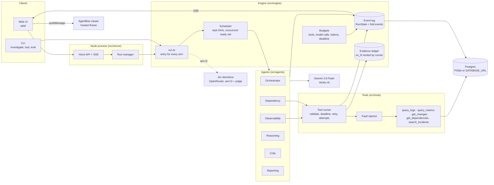

# Architecture

Rootline investigates incidents in a fictional Indian investing app. Six agents with distinct
inputs, outputs, tools and authority coordinate through a shared, event-sourced run state. A
small hand-written engine (no agent framework) schedules their work, enforces budgets and
decides when to stop.

## Components



- **Data:** one Postgres schema (`src/db/schema.sql`). PGlite (in-process Postgres) by default;
  node-postgres against the Deltabase-hosted database when `DATABASE_URL` is set. Tools run
  fixed, parameterized, world-scoped queries; no agent ever writes SQL or sees a world id.
- **Model layer:** `gemini-3.8-flash` for every agent in every arm and for the baseline, at the
  same thinking level. Structured outputs come from zod schemas converted to Gemini's schema
  subset and re-validated with zod (one repair call). Tool loops use function calling and append
  the model's parts verbatim to continue a turn.

## One run (arm A)

```mermaid
sequenceDiagram
  autonumber
  participant E as Engine (code)
  participant O as Orchestrator
  participant S1 as Observability
  participant S2 as Dependency
  participant R as Reasoning
  participant C as Critic
  participant P as Reporting
  E->>O: incident, catalog, dependency graph, budget
  O-->>E: plan (2-6 tasks)
  Note over E: validate: known services, window, both roles,<br/>dedupe; one repair, else default plan
  par specialists run concurrently
    E->>S1: task (logs and metrics)
    S1->>S1: tool loop: query_logs / query_metrics
    S1-->>E: findings (facts and inferences citing ev_N, gaps)
  and
    E->>S2: task (changes, dependencies, history)
    S2->>S2: tool loop: get_changes / get_dependencies / search_incidents
    S2-->>E: findings
  end
  E->>R: ledger, findings, gaps, previous hypotheses
  R-->>E: ranked hypotheses v1 (support, counterevidence, onset)
  E->>E: critic checks (citations, chronology,<br/>overconfidence, counterevidence, top-two gap)
  E->>C: hypotheses, checks, ledger, tool failures, budget
  C-->>E: investigate + follow-up tool calls
  Note over E: validate follow-ups: role owns tool, params valid,<br/>novel fingerprint, budget, at most 4
  par follow-ups run concurrently
    E->>S1: critic's exact call first, then up to 3 more
  and
    E->>S2: critic's exact call first, then up to 3 more
  end
  E->>R: updated ledger and objections
  R-->>E: hypotheses v2
  E->>C: round 2
  C-->>E: accept
  Note over E: stop reason decided in code
  E->>P: final state, stop reason
  P-->>E: report (code checks citations and the honesty rule)
```

## How the agents coordinate

Agents never call each other. They read and write the shared run state, and the engine decides
what runs next from that state.

| Agent | Reads | Writes | Tools | Authority |
| --- | --- | --- | --- | --- |
| Orchestrator | incident, catalog, dependency graph, budget (arm B: candidates) | plan of 2-6 tasks | none | proposes tasks; code validates and schedules them |
| Observability | its task, catalog | findings: facts/inferences citing evidence, gaps | `query_logs`, `query_metrics` | chooses its own queries within its tool budget |
| Dependency | its task, catalog, dependency graph | findings | `get_changes`, `get_dependencies`, `search_incidents` | same |
| Reasoning | ledger, all findings and gaps, previous hypotheses, critic objections | versioned ranked hypotheses | none | ranks, keeps or drops hypotheses |
| Critic | hypotheses, code checks, ledger, tool failures, executed queries, budget | accept / investigate / insufficient_evidence, objections, follow-up tool calls | none | can extend the investigation, within code limits |
| Reporting | final state, stop reason, last critic decision | report | none | writes the report; code enforces citations and honesty |

What makes this more than chained prompts:

- **Structured results, not prose hand-offs.** Every output is a zod-validated object.
  Evidence ids in it are checked against the ledger; unknown ids raise `citation.invalid`
  events and are removed.
- **The critic changes the work.** Its follow-up requests are concrete tool calls. Code turns
  them into new tasks (checking role authorization, parameters, novelty and budget) that run in
  parallel and feed the next reasoning round.
- **Parallelism and dependencies are real.** Tasks form a DAG; independent tasks run
  concurrently in a bounded pool (tests assert overlapping execution). A dependency is satisfied
  when its task is terminal, so a failed specialist never blocks reasoning.
- **Termination is decided in code** with a typed stop reason: `critic_accepted`,
  `critic_insufficient_evidence`, `max_rounds`, `no_new_evidence`, `budget_tool_calls`,
  `budget_llm_calls`, `budget_tokens`, `deadline`, `cancelled`, `unrecoverable_error`, or
  `completed` (arms without a critic).

## The orchestrations (arms)

All arms share the agents, tools, tool runner, ledger, budgets, fault injection, model,
thinking level, objective text (`src/agents/prompts/objective.md`) and report schema.

| Arm | Flow |
| --- | --- |
| A. Split by source, then critique | plan → specialists by data source → reasoning → critic → follow-up rounds → report |
| B. Causes first | reasoning proposes 3-4 candidate causes before any tool call → plan tasks that discriminate them → as A |
| C. A without the critic | plan → specialists → reasoning → report (one round) |
| D. Jev-assisted | the base arm (picked on dev scenarios) plus Jev screening tool output, grading evidence against hypotheses and checking citations, so Flash reads less |
| E. Single-agent baseline | one agent, all five tools, one sequential tool loop, `submit_report` with the same report schema |

## State and events

Every change is a typed, zod-validated event with `seq`, `ts`, `runId`, `type`, optional
`taskId` and `payload`: `run.created`, `plan.proposed`, `plan.validated`, `plan.rejected`,
`plan.fallback`, `candidates.proposed`, `task.scheduled`, `task.started`, `llm.call`,
`jev.call`, `jev.decision`, `tool.attempt`, `tool.result`, `evidence.recorded`,
`citation.invalid`, `specialist.findings`, `agent.output`, `task.completed`, `task.failed`,
`hypotheses.updated`, `critic.checks`, `critic.decided`, `followup.scheduled`,
`followup.rejected`, `budget.exhausted`, `report.ready`, `run.terminated`.

`RunState = fold(events)` (`src/engine/run-state.ts`). The same log drives persistence
(`investigation_events` and derived tables), live SSE, replay, the Agentflow graph and evaluation
scoring. A test checks that folding the persisted events reproduces the live state exactly.

## Evidence

- The tool runner mints evidence ids (`ev_1`, `ev_2`, ...) for every ok or partial result. An
  empty complete result is evidence (a negative observation); an error is a gap, not evidence.
- Each record keeps the canonical request, services, window, completeness, record count, source
  record references (log ids, metric series keys, change ids, ...), a bounded excerpt and notes.
- Claims carry `fact | inference | assumption`. A "fact" with no valid evidence is downgraded
  (specialists) or moved to assumptions (reports), and the event log records it.

## How failures are contained

| Failure | Handling |
| --- | --- |
| Tool timeout / unavailable / rate limited | Per-attempt deadline that really elapses; up to 2 retries with backoff; every attempt is a `tool.attempt` event; the final error goes back to the agent as a gap |
| Partial results | Passed through with `completeness: partial` and coverage notes; still evidence |
| Invalid tool input | Not retried; a useful message goes back to the agent, which can fix the call |
| Invalid agent output | One repair call with the validation error, then the task fails with a gap |
| Failed specialist | Its task fails; reasoning runs on what exists and sees the failure as a gap |
| Reasoning fails twice | Outcome `failed`; a clearly labeled report is built from the ledger by code |
| Model 429 / 5xx / network | Bounded exponential backoff (3 attempts), each attempt recorded; 400s never retried |
| Plan call fails | The run falls back to the default plan and says why, instead of ending with no investigation |
| Report call hangs | The report gets a fixed grace period past the run: 120 s after a deadline, 300 s otherwise. If that runs out too, a labeled report is built by code |
| Tool budget used up | A notice tells the model to submit. The first such turn stays an ordinary request, so it can still hit the implicit cache; only if the model ignores it, or the budget allows no second try, is the turn restricted to the submit function |
| Budget or deadline exhausted | The run stops investigating and goes to reporting with whatever exists; the final report call is always allowed once |
| Cancellation | An `AbortController` per run, honored by tools and model calls; a code-built report |
| Unsupported certainty | The honesty rule: if the critic found the evidence insufficient, or the run stopped on a budget or deadline without critic acceptance, a "conclusive" report needs a justification or is downgraded to inconclusive, and the inconsistency is flagged |

## Faults are the same for every arm

Fault profiles (`fixtures/v1/<world>/faults.json`) are applied at the tool boundary and matched
on the tool, a predicate over the canonical request, and the attempt number, never on call
order. Background transient faults are decided by `hash(seed, tool, canonical request, attempt)`.
So every arm and the baseline meet exactly the same faults for the same logical request.

## Agentflow view

The home page and the run view embed the separately hosted Agentflow viewer. The home page
replays a recorded evaluation run for the chosen incident and orchestration, with its graded
outcome from `eval/results/summary.json`; it starts no model calls. `src/flow/agentflow.ts` maps the
event log to viewer nodes (live `flow:sync` snapshots; `flow:replay` built from recorded event
timestamps, compressed to about 60 s when a run took longer than 90 s, with the factor shown).
Rounds become new nodes because the viewer has no cycles. The viewer is a visualization, not a
source of truth.

Node labels are short names (`Logs & metrics`, `Critic round 2`). The viewer gives every label a
fixed 176 px box but narrows its columns as a run gets deeper, so long labels on the same row
overlapped. Each task's question is in the run view's Tasks tab. For deep runs, `web/src/fit.ts`
lays the viewer out wide enough for its widest label and scales it to the panel; the note under
the graph says when it does. That fitting is a workaround for the currently deployed viewer: the
Agentflow project has an unlanded change that fits labels inside the viewer, and once it ships,
`fit.ts` should be removed so deep runs are not shrunk twice.
