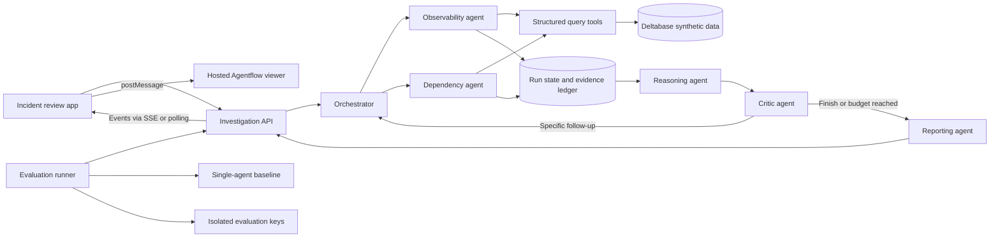

# Multi-Agent Production Incident Investigation System — design proposal

> **Build decisions (2026-11-01).**
>
> - **Product name:** Rootline. The fictional system under investigation is an Indian investing
>   app with an AI assistant built in (§3).
> - **Model:** `gemini-3.8-flash` on Vertex AI (global endpoint) for every agent and the
>   baseline. The Jev decision model (via OpenRouter) makes small typed decisions in one
>   orchestration and judges the evaluation.
> - **Comparison:** four multi-agent orchestrations plus the single-agent baseline, on the same
>   tools, limits, incidents and model. Evaluation budget: $50.
> - **Language:** TypeScript on Node.js, with no agent framework.
> - **Data (resolves §8 and §15):** the query tools use Postgres SQL everywhere. They run on **PGlite**
>   (in-process Postgres) by default for local runs, tests and reviewers, and on a dedicated
>   **Deltabase**-hosted Postgres database when `DATABASE_URL` is set (the hosted demo). The
>   canonical, downloadable corpus is the versioned fixture files in the repo.
> - **Hosting:** `rootline.slate-app.online`, deployed separately from the build.
> - **Repository:** `github.com/varun-a-1010/rootline` (public).
> - **Scope:** all 14 proposed scenarios, all of them evaluated.
>
> Where this document and `docs/brief.md` differ, the brief wins. `docs/assignment.md`
> beats both.

---

**Status:** Proposed build specification
**Audience:** Builder and assignment reviewer
**Product name:** Working title; choose before submission
**Target:** A hosted demonstration and reproducible evaluation for Orange Invest's AI Engineer assignment

## 1. Purpose

Build a multi-agent system that investigates production incidents in a fictional Indian investing app with an AI assistant built in. It must retrieve and compare evidence, develop competing explanations, challenge its own conclusions, and recommend operational corrective actions. Its output should remain honest when evidence is missing, contradictory, or a tool fails.

The system will be developed in a **separate repository**. It will use a dedicated Deltabase database for synthetic operational data and embed the existing hosted Agentflow viewer to display live investigation progress. The hosted application is the primary review experience; the submission will also include documented evaluation results and downloadable synthetic fixtures.

### Context and boundaries

Orange's [homepage](https://www.orangeinvest.app/) describes a financial companion people can call, starting with investments. Its [privacy policy](https://www.orangeinvest.app/privacypolicy) describes Padii as a financial education and information platform and refers to voice and chat inputs. The assignment itself asks for an incident investigation system. The fictional system under investigation is therefore an investing app with an AI assistant inside it, so its incidents resemble the ones such a product would face.

The fictional application, architecture, incidents, service names, users, datasets, and failures in this document are **invented**. They are not claims about Orange's infrastructure, customers, practices, or incidents. The system investigates service reliability and information quality; it does not give personalized investment advice or execute financial transactions.

## 2. What success looks like

A reviewer opens the hosted application, selects a synthetic incident, starts an investigation, and can inspect:

1. The incident report and affected services.
2. Live agent tasks and their dependencies in Agentflow.
3. Tool calls, returned records, failures, retries, and evidence gaps.
4. Competing hypotheses, including supporting and contradicting evidence.
5. The critic's specific objections and any resulting follow-up investigation.
6. A final report with ranked hypotheses, calibrated confidence, uncertainty, and evidence-backed operational actions.
7. Evaluation results comparing the multi-agent system with a single-agent baseline on the same incident corpus.

The system must be able to conclude **inconclusive**. A polished graph or fluent answer alone is not evidence of a successful investigation.

### Acceptance criteria

- Six distinct roles exist: orchestrator, observability, dependency, reasoning, critic, and reporting.
- Agents exchange schema-validated structured results through shared run state. The critic can request concrete follow-up work that changes the investigation.
- Independent initial investigations execute in parallel; task dependencies and subsequent rounds are explicit.
- Five query tools cover logs, metrics, deployments/configuration, dependencies, and historical incidents. All have structured inputs/outputs and support reproducible errors or incomplete results.
- Runs have bounded retries, tool-call and iteration limits, a deadline, and explicit terminal outcomes. Individual agent or tool failures are recorded and handled without fabricating evidence.
- Reports distinguish returned facts from inference and assumptions, link claims to evidence, discuss counterevidence, and allow insufficient evidence.
- At least 10 synthetic incidents are tested, including misleading evidence, conflicting observations, and simulated tool failures.
- The baseline uses equivalent tools, data access, incident input, model configuration where practical, and documented comparable limits.
- Results include root-cause accuracy, evidence grounding, tool calls, elapsed latency, and input/output token usage, including unknown usage where relevant.
- Setup and runtime dependencies, dataset availability, evaluation method, limitations, architecture, and the requested coding-assistant transcript are provided.

## 3. Fictional system under investigation

The system under investigation is a fictional Indian investing app with an AI assistant built in. Users buy stocks and mutual funds, run SIPs on UPI autopay, track their portfolio, redeem to their bank account, and ask the assistant about funds and their own holdings.

| Component | Simulated responsibility | Example operational signal |
| --- | --- | --- |
| `api-gateway` | Receives app requests | request errors, p95 latency |
| `auth-service` | OTP login | OTP success rate, SMS send errors |
| `order-service` / `broker-connector` | Stock orders and the broker/exchange APIs | order success rate, rate-limit responses |
| `mf-order-service` | Mutual fund purchases and SIPs | order and SIP counts, failures |
| `mandate-service` | UPI autopay and e-mandates through NPCI | mandate success rate by bank |
| `payment-service` / `debit-worker` / `bank-connector` | Collects SIP instalments from banks | debit counts, retries, bank latency |
| `portfolio-service` | Holdings, values, P&L | value computation errors, staleness |
| `market-data-service` | Stock prices, and fund NAVs from the AMFI feed | NAV age, feed errors |
| `payout-service` | Redemptions back to bank accounts | batch duration, lock waits |
| `kyc-service` | KYC through the registration agency | pending count, webhook errors |
| `notification-service` | SMS, push and email | send failures |
| `assistant-orchestrator` | Runs each assistant conversation | token use, retries, request completion |
| `llm-provider` | Produces model responses (external) | response latency, rate limits |
| `knowledge-index` / `indexing-pipeline` | Fund factsheets and help articles | index version, freshness |
| `user-context-service` | The user's holdings, for personal answers | timeouts, missing-context rate |
| `compliance-filter` | Blocks direct buy/sell advice (SEBI) | block rate |
| `cache` / `database` / `job-scheduler` / `message-queue` | Shared infrastructure | hit rate, lock waits, queue depth |

External partners (banks, NPCI, the broker and exchange, the AMFI feed, the KYC agency, the SMS provider and the LLM provider) can each fail in ways that look like the app's own fault.

These components are **records in a synthetic environment**, not a requirement to run real microservices. All names, values, customers, and provider integrations are fictional. Do not use real customer data or imply an actual Orange service integration.

## 4. Architecture

### Main components

- **Investigation API:** starts runs, exposes run state and structured event history, and enforces access, budgets, and cancellation.
- **Orchestration engine:** manages tasks, specialist agents, shared state, dependencies, parallelism, follow-up rounds, and termination.
- **Query tools:** provide bounded read-only access to the synthetic world through typed requests and responses.
- **Evidence ledger:** stores source-linked tool results, their completeness, and agent interpretations as separate items.
- **Agentflow adapter:** maps actual run events to the viewer's node, status, and replay contract.
- **Evaluation runner:** runs both approaches with matching scenarios, captures metrics, and scores outputs against separate labels.
- **Fixture and answer-key artifacts:** versioned, reproducible synthetic data and independently maintained evaluation labels; the agent tool layer never exposes answer keys.

Initial implementation may use one application process with modular components. A distributed deployment is not needed merely to demonstrate multiple agents.

## 5. Agent responsibilities and coordination

Agents are distinct by their tasks, tools, input/output schemas, and decision authority—not only by system prompts. They collaborate through the shared run state and explicit orchestrator decisions.

| Agent | Input | Responsibilities | Structured output |
| --- | --- | --- | --- |
| Orchestrator | Incident, current state, remaining budget | Plan initial tasks, run independent tasks concurrently, schedule follow-ups, enforce budgets and termination | Tasks, assignments, dependencies, stop reason |
| Observability | Service/time scope and investigation question | Query logs and metrics; identify trends, anomalies, conflicts, and missing data | Observations, evidence references, gaps, suggested next queries |
| Dependency | Service/time scope and investigation question | Query deployments, config changes, dependencies, and related historical incidents | Timeline, dependency findings, evidence references, gaps |
| Reasoning | Evidence ledger and incident | Form and rank alternative causes; list support, contradictions, assumptions, and discriminating tests | Hypotheses with evidence links and uncertainty |
| Critic | Hypotheses, evidence, tool health, constraints | Check evidence quality, chronology, alternative explanations, missing results, and unsupported claims | Accept, request targeted follow-up, or flag insufficient evidence |
| Reporting | Approved investigation state and stop reason | Produce a source-linked report that accurately reflects uncertainty and tool limitations | Final structured report and readable rendering |

A history search can be delegated to the dependency agent; it does not require a seventh role. The orchestrator may be code-led, model-led, or hybrid, but its planning and scheduling decisions must be inspectable and constrained by code.

### Investigation lifecycle

1. **Initialize:** validate the incident and time window, set budget, create run state, and record the selected dataset and scenario versions.
2. **Plan:** derive targeted observability and dependency questions. State what each task is intended to establish.
3. **Investigate in parallel:** run independent specialist tasks. Record each tool request, result, completion status, and stable evidence ID.
4. **Synthesize:** compare candidate hypotheses using available evidence; distinguish observations from interpretations.
5. **Critique:** accept the current evidence, request specific additional work, or identify an unresolved gap. The critic cannot cause unbounded loops.
6. **Follow up:** execute permissible requests, update evidence and hypotheses, then repeat reasoning/critique within a configured iteration and time budget.
7. **Terminate and report:** finish when sufficiently supported, no useful follow-up remains, or a limit/failure requires termination. A budget-exhausted run is not automatically considered proven.

A failed specialist should leave a structured error and gap; independent completed work remains available. Retry only retryable failures and record every attempt. If the report can be produced honestly from remaining state, produce it with limitations; otherwise return a clear failed or inconclusive outcome.

### Illustrative interaction

An incident reports slow assistant answers around 10:05. The dependency agent finds an `assistant-orchestrator` deployment at 10:04; observability finds `market-data-service` latency began at 10:01. The reasoning agent lists both a deployment regression and an upstream provider slowdown. The critic asks for a provider error/latency breakdown and a comparison with unaffected routes. A follow-up query yields partial results. The report identifies what the evidence supports, what remains uncertain, and whether the system has enough to rank either cause confidently.

## 6. Shared state and evidence

Use typed, versioned structures. The exact implementation language is a build decision; the following is the logical contract.

### Investigation state

- `run_id`, incident reference, dataset version, arm (one of four multi-agent orchestrations or the single-agent baseline), timestamps, status, and stop reason.
- Task list with agent role, requested question, dependencies, status, start/end times, and result references.
- Evidence records and tool-attempt records.
- Hypothesis versions, critic decisions, follow-up requests, and final report.
- Remaining budgets: deadline, model calls/tokens where enforceable, tool calls, attempts, and critique rounds.
- Audit metadata: model/provider/version, prompt/config version, scenario seed, timing, and usage availability.

### Evidence record

Each evidence item should include a stable ID, tool name, source record references, service, observation time/window, retrieval time, returned value or bounded excerpt, and completeness (`complete`, `partial`, `unknown`). Record any filtering or limitations. Do not allow an agent-generated claim to masquerade as a raw source observation.

### Hypothesis

Each hypothesis should include a cause description, ranking, confidence, supporting evidence IDs, contradicting evidence IDs, assumptions, missing discriminating evidence, and recommended next checks. Confidence is a reasoned estimate, not a measured probability unless separately calibrated. Avoid portraying uncertainty as certainty.

### Critic decision

Return one of `accept`, `investigate`, or `insufficient_evidence`, with a rationale and specific follow-up queries where appropriate. Code validates the decision and checks budget and tool authorization before dispatch.

### Report

Include incident summary; ranked hypotheses; facts, assumptions and counterevidence; confidence and gaps; timeline; operational corrective actions and suggested verification; tool failures; stop reason; and cited evidence IDs. The report must not imply an action has been executed.

## 7. Tools and fault simulation

All tools use typed inputs and outputs and apply the same query behavior to all incidents—no incident-ID-specific diagnostic shortcuts or hardcoded answers.

| Tool | Typical input | Output |
| --- | --- | --- |
| `query_logs` | services, time interval, severity and search filters, page/limit | matching structured log records, pagination and completeness |
| `query_metrics` | service, metric, time interval, aggregation/resolution | time-series points, units, coverage and completeness |
| `get_changes` | services, time interval, change types | deployments and configuration events with timestamps |
| `get_dependencies` | service, depth and optional time | service relationships with known metadata |
| `search_incidents` | services, symptoms, time filters and limit | historical summaries and relevant references |

Each result includes status, source, observation window, returned records, completeness/coverage, and an error when applicable. Differentiate an empty complete result from a timeout, partial result, or unknown coverage.

### Reproducible failures

The evaluation harness can inject deterministic timeouts, transient errors, incomplete responses, and retry success/failure based on a scenario version and seed. Use a shared fault-injection layer at the tool boundary; do not encode solutions in it. Keep failure schedules equivalent between the baseline and multi-agent run while accounting for different call order, for example by matching on logical request characteristics and attempt number.

Use per-tool deadlines and bounded retries. Record each attempt, including failures and partial responses. Never silently fill missing results with invented data.

## 8. Deltabase and synthetic fixtures

Create a dedicated application/database for this project and use a separate runtime identity scoped to synthetic data. Follow the Deltabase connection and schema-authoring workflow applicable to the new repository; verify the exact target before any mutation. Do not use Slate's live product database or real user data.

### Proposed logical datasets

- `incident_reports`: public-to-agents incident input and time window.
- `service_catalog` and `service_dependencies`: fictional services and relationships.
- `log_events`: timestamped, service-tagged structured events and bounded messages.
- `metric_series` / `metric_points`: metric names, units, timestamps, service, and values.
- `change_events`: deployments, versions, and configuration changes.
- `historical_incidents`: earlier simulated summaries and evidence references.
- `investigation_runs`, `investigation_events`, and `evidence_records`: optional application run persistence, subject to final storage design.

The exact schema and indexes follow access patterns and Deltabase's supported authoring process; this document does not prescribe a schema migration. Use explicit timestamps/timezones and preserve source timestamps where a scenario includes clock skew.

### Data access and reproducibility

- Query tools expose narrowly scoped read access; reviewers do not need database credentials.
- A reviewer can inspect returned data and tool results in the UI, with a downloadable corpus where appropriate.
- Keep a versioned fixture export and deterministic loading instructions so the synthetic environment can be recreated if the hosted database is unavailable.
- Keep evaluator labels and fault schedules outside the agent-visible tool surface. If distributed for reproducibility, label their visibility and ensure the runtime tool identity cannot retrieve them. Separation is a tool-access control, not a claim that shipped files are secret.
- Record fixture version/hash and query/scenario configuration with evaluation results.
- All seeded examples are fictional and clearly labeled; avoid real personal data, secrets, or actual Orange internal details.

## 9. Dataset and test design

Build at least 12 hand-reviewed incidents, with at least 10 evaluated. Each fixture needs a coherent timeline, multiple evidence sources, a defensible cause or explicit inconclusive label, and realistic alternatives. The following are **scenario proposals**, not claims about Padii.

| ID | Scenario | Intended challenge / evaluator label |
| --- | --- | --- |
| 01 | Portfolio shows yesterday's values near an unrelated portfolio deployment | The overnight NAV import failed before the deployment; recognize misleading chronology. |
| 02 | Assistant replies take 20 s or more | LLM provider throttling, with a concurrent knowledge-index rebuild as a distractor. |
| 03 | Assistant starts giving direct "buy this fund" advice | A prompt change weakened the compliance filter; separately inspect the same-day LLM model update. |
| 04 | Stock orders fail at the 09:15 IST market open | Broker rate limiting versus app capacity; use metrics and rate-limit evidence. |
| 05 | Assistant says the user holds no funds | Context-service timeouts plus a stale empty cache; distinguish missing from old data. |
| 06 | SIP debited twice | A bank slowdown interacting with a shortened retry timeout, near an unrelated release. |
| 07 | Assistant quotes an old expense ratio | The factsheet update never reached the index despite a healthy search service. |
| 08 | Portfolio values 100× too high | A config regression treats paise as rupees, with healthy upstream values. |
| 09 | Autopay setup fails for some users | One bank's mandate API fails; do not mistake 94% overall success for full health. |
| 10 | A past incident looks like a match | The current cause is our own config change, not the past broker outage; past similarity is a lead, not proof. |
| 11 | Deployment and alert times appear inconsistent | One source logs IST without an offset, which changes event ordering. |
| 12 | OTP login failures with critical logs missing | Insufficient evidence; an unsupported definite diagnosis is a failure. |
| 13 | Redemption payouts delayed and the metrics tool times out | Retry and/or use alternative data within limits; disclose remaining coverage gaps. |
| 14 | KYC stuck at pending, with conflicting evidence and repeated tool failure | Remain inconclusive when competing causes cannot be distinguished. |

During fixture authoring, define the exact timestamps, causal mechanism, evidence IDs, red herrings, coverage, allowable outcomes, and fault schedule for each case. Have a human inspect whether the labeled answer follows from evidence available through the tools. Include cases where multiple causes are defensible and grade them explicitly rather than forcing an artificial single answer.

Use development cases for implementation and a held-out set or held-out variants for final reporting. Track changes to fixtures and prompts; do not tune against final labels and then present the same evaluation as untouched. Ensure held-out cases vary more than just service or incident names.

## 10. Evaluation design

### Fair baseline

A capable single agent receives the same incident, tool access, data, failure scenario, system-level task objective, and ability to make sequential follow-up calls. Use the same model/provider and comparable total call/time/token budgets when possible. Record any unavoidable differences, including whether concurrency differs. Do not compare against an intentionally weak one-shot answer.

Both systems run on the same dataset version and fault scenario. Use paired repetitions with recorded seeds and model settings when practical; model outputs can still vary. Report per-case outcomes, aggregate counts, and repeated-run variation. Small synthetic samples are illustrative, not proof of production performance.

### Required metrics

| Metric | Proposed measurement |
| --- | --- |
| Root-cause accuracy | Per-case top-ranked cause versus reviewed label; report correct/total separately for conclusive cases. For multi-cause cases define acceptable labels before running. |
| Handling insufficient evidence | Separately report correct abstentions and unsupported definitive diagnoses on inconclusive cases; also report false abstentions on conclusive cases. |
| Evidence grounding | Audit material claims for valid references and whether returned records actually support them. Report supported material claims / assessed material claims, fabricated references, and missed required counterevidence. Human review resolves ambiguous support. |
| Tool-call count | Total calls and attempts, including timeouts, retries, and failures; show per-run and aggregate. |
| Latency | Wall-clock time from run start to terminal report, plus useful per-stage timing; report model/network and runtime environment. |
| Token consumption | Provider-reported input/output tokens including retries, grouped by role and run. Mark missing usage as unknown and do not replace it with zero. |

Record confidence and compare it to outcomes as an exploratory calibration check, without claiming statistical calibration from a tiny dataset. Include critic-triggered follow-up rate, correct recovery from faults, and tool-result completeness as supplementary diagnostics.

### Preventing grading shortcuts

- The diagnosis must be supported by evidence the agent actually obtained, not merely match a label.
- Distinguish missing/failed queries from negative results.
- Review whether cited evidence entails each consequential claim and whether counterevidence is fairly represented.
- Define scoring rules and answer keys before final evaluation runs; preserve individual outputs and rubric judgments.
- Record model versions, run time, limits, fixture hashes, and failure seeds. Do not fabricate results or imply the multi-agent approach necessarily wins.

### Automated tests

Test tool input validation, query filtering, complete/empty/partial/error semantics, retry limits, deterministic fault scenarios, task dependency and actual parallel scheduling, evidence provenance, critic-driven follow-up, termination, inconclusive reporting, evaluation isolation, and stable scoring. Integration tests should exercise both approaches against the same seeded fixture and verify persisted run events and final reports. Model-dependent runs are separate from deterministic tests and must record provider requirements and cost.

## 11. Agentflow integration and reviewer experience

The animated graph belongs to the separate Agentflow app. Slate embeds it via an iframe and translates Pro run state to the viewer contract. This project can reuse the hosted viewer directly without including its source repository in the assignment.

1. Embed the configured Agentflow viewer URL in the incident app.
2. Wait for the `flow:ready` handshake and validate the expected viewer origin and iframe source.
3. Send `flow:init`, then complete ordered `flow:sync` snapshots based on **actual** investigation events. Use `flow:terminal` on completion.
4. For finished runs, use `flow:replay` only from recorded timestamps/events. Label any compressed timing or reconstruction honestly.
5. Map a follow-up task to a new node or attempt rather than implying a graph cycle the viewer cannot represent. Show richer evidence and tool details in the surrounding app.
6. Verify deployed embedding policy and origin/CSP settings for the chosen subdomain before relying on the integration.

The viewer is a visualization, not an orchestrator or source of truth. Browser-delivered code can be inspected by visitors; reuse of the hosted viewer avoids distributing the Agentflow source repository but does not make frontend code invisible.

### Minimal UI

- Incident selector with clear synthetic-data label.
- Start investigation and view status; optional cancel if implemented.
- Live Agentflow panel.
- Event/evidence panel with source records, timestamps, partial results, errors, and retries.
- Hypotheses and critic decisions, including follow-up requests.
- Final report, run metadata, and evaluation comparison.
- Links to fixture export, architecture, setup, technical note, and transcript where included.

No polished frontend is required. Never display made-up progress or imply a query or agent ran when it did not.

## 12. Deployment, access, and dependencies

Deploy the incident application on a dedicated subdomain of the existing server, with the new repository and deployment configuration isolated from Slate. Embed the separately hosted Agentflow viewer and connect the application to its own synthetic Deltabase instance. Exact domain, hosting process, infrastructure changes, and access method are implementation decisions, not assumptions in this document.

The reviewer should have a convenient path to the demo and its completed sample results. Document any access restrictions, external LLM provider/API dependency, Deltabase dependency, Agentflow dependency, rate limits, model variability, and cost or availability constraints. Use server-side secrets, bounded requests, and separate per-run data; do not expose database or provider credentials to the browser. If the app is available to others, limit abuse and unexpected model spend.

A hosted demo is useful but may not by itself satisfy a reviewer's interpretation of “runnable implementation.” Document how to run the system and restore fixtures, and clarify with the company if distribution without source is acceptable when that becomes necessary. No claim is made that this assignment requires or waives source-code submission.

## 13. Deliverables

1. **Runnable incident investigation app:** hosted demonstration plus accurate setup and dependency instructions for the delivery form chosen.
2. **Architecture and coordination explanation:** this specification, updated to reflect actual implementation and decisions.
3. **Synthetic dataset and tests:** versioned fixtures, labels isolated from agent tools, fault schedules, and automated test instructions.
4. **Comparative evaluation:** actual per-case and aggregate results, versions, rubric, raw or reviewable evidence, model/tool/latency/token measurements, and limitations.
5. **Technical note:** at most 500 words, based on the final implementation and actual results.
6. **Coding-assistant transcript:** provide the requested transcript, scoped to this project; review before sharing to avoid exposing unrelated private material or credentials.
7. **Optional demonstration recording:** show a meaningful critic-driven follow-up, a failed/partial tool result, and an inconclusive case if available.

The Agentflow source repository and Slate source repository are not deliverables. Identify Agentflow as an external hosted dependency and make clear what code or artifacts the reviewer receives.

## 14. Implementation sequence

### Phase 1: Foundation and fixture design

- Create the separate repository and choose stack and naming.
- Define contracts for incidents, tools, evidence, hypotheses, agent results, events, and reports.
- Design and review the fictional service graph and initial dataset. Define answer-key and fault-injection isolation.
- Set up a dedicated Deltabase environment and versioned fixture loading/export process.
- **Checkpoint:** deterministic queries return expected records and distinguish complete, empty, partial, and failed results.

### Phase 2: Investigation engine

- Implement bounded tool wrappers, evidence ledger, and run state.
- Implement agents and scheduler with concurrent independent tasks, explicit dependencies, and a critic-driven follow-up loop.
- Implement retries, deadlines, cancellation behavior, and inconclusive reporting.
- **Checkpoint:** inspect a real trace showing parallel tasks, a contradiction, a critic request, and a resulting follow-up.

### Phase 3: Baseline and evaluation

- Implement the single-agent baseline using the same tool interface.
- Complete the scenario set, reviewed labels, held-out variants, fault schedules, and scoring rubric.
- Add deterministic tests; run model-based paired evaluations with documented budgets.
- **Checkpoint:** produce honest per-case and aggregate results for all required measures, including failures and unknown usage.

### Phase 4: Viewer and delivery

- Build a minimal incident review UI and connect actual progress events to hosted Agentflow.
- Implement evidence, hypothesis, report, and evaluation views; supply a fixture export and sample runs where practical.
- Deploy on a dedicated subdomain and document setup, dependencies, limitations, and the transcript.
- **Checkpoint:** a reviewer can select a case, run or inspect an investigation, follow citations, and understand the comparison.

## 15. Open decisions

- Final app name, repository, and subdomain.
- Language/framework and model provider, including budget and cost ceilings.
- Whether run state is persisted in Deltabase or another approved project-owned store.
- Reviewer access approach and whether a source-free executable/container meets the company's expectations.
- Final dataset size, repetitions, held-out split, and whether a human reviewer can independently audit grounding.
- How to deliver the assistant transcript safely and completely for the project.

## 16. Draft technical note template (under 500 words)

> We built a multi-agent incident investigator for a fictional investing app with an AI assistant built in. An orchestrator runs independent observability and dependency investigations, stores source-linked results, and asks a reasoning agent to compare possible causes. A critic reviews contradictions and missing evidence and can request bounded follow-up queries. The reporter summarizes ranked hypotheses, confidence, counterevidence, and corrective actions; it can return an inconclusive result.
>
> Synthetic operational records are stored in a dedicated Deltabase environment and exposed through structured read-only tools. Tool failures and incomplete responses are reproducible, and every attempt is recorded. The hosted interface embeds the separately maintained Agentflow viewer; its graph is driven by recorded investigation events. We compared the system with a single agent using the same tools, incident inputs, and documented limits.
>
> The evaluation covers [actual case count] scenarios, including misleading evidence, contradictory observations, and tool failures. On the evaluated set, [insert actual results and uncertainty]. The multi-agent approach [insert observed trade-off in accuracy, grounding, latency, calls, and tokens without overstating the result].
>
> Limitations include the synthetic dataset, [insert actual implementation limitations], model variability, and the dependency on [actual services]. Future work could expand held-out incident diversity, independently review grounding and calibration, and test integration with real observability systems using appropriately authorized data.

Replace all placeholders with verified facts after implementation and evaluation. This draft is not a claim that the system or evaluation already exists.
